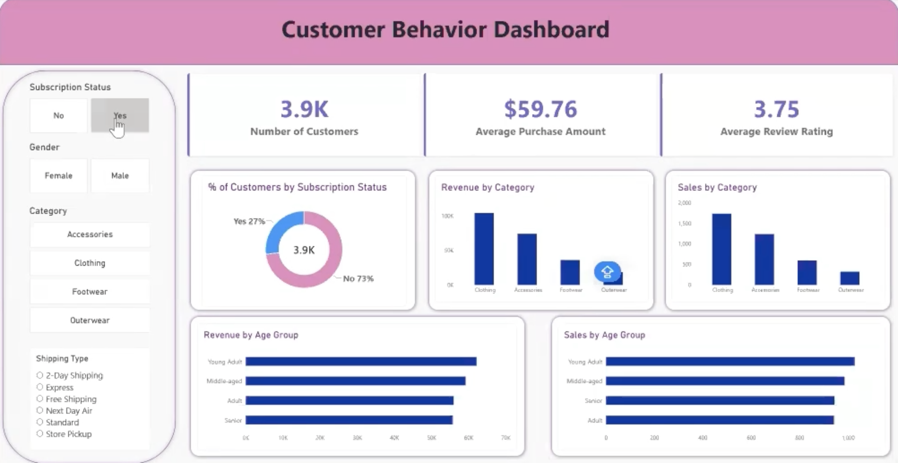

# 🛒 Customer Shopping Behavior & Revenue Growth Analysis

[](https://www.python.org/)
[](https://www.postgresql.org/)
[](https://powerbi.microsoft.com/)
[]()

An end-to-end data analytics project bridging the gap between raw transactional data and executive decision-making. This repository demonstrates a complete analytics workflow—from rigorous data engineering in Python and relational modeling in PostgreSQL to executive-level visualization in Power BI—designed to decode consumer behavior, diagnose revenue bottlenecks, and optimize retention strategies.

---

## 📊 Executive Summary & Business Context

In modern retail, organizations rarely lack data—they lack clarity. This project analyzes **3,900 customer transactions across 18 variables** to address a critical enterprise challenge: 
> *Which consumer behaviors drive long-term lifetime value (LTV), and where is the business leaving revenue on the table?*

### Key Strategic Findings:
1. **The Subscription Bottleneck:** While **3,116 customers** qualified as repeat/loyal buyers, **only 27% (1,053 buyers)** were enrolled in the paid subscription program. Interestingly, average spend between subscribers ($59.49) and non-subscribers ($59.87) was nearly identical—revealing a major opportunity to convert high-frequency buyers into high-margin recurring subscribers.
2. **Discount Dependency & Margin Leakage:** Quantified the impact of promotional codes and seasonal discounts on average order value (AOV) and category profitability.
3. **Demographic & Regional Nuances:** Segmented purchasing patterns by age cohorts, payment methods, and shipping preferences to refine targeted marketing campaigns.

---

## 🛠️ Tech Stack & Architecture


```

[ Raw CSV Data ]
│
▼  (Python / Pandas: Cleaning, Imputation, Feature Engineering)
[ Cleaned Dataset ]
│
▼  (PostgreSQL: Relational Modeling & Advanced SQL Queries)
[ Structured DB ]
│
▼  (Power BI: Executive Dashboard & Interactive Visuals)
[ Business Insights & Strategic Roadmap ]

```

* **Data Engineering & Preparation:** Python, Pandas, NumPy
* **Database & Querying:** PostgreSQL, Advanced SQL (Window Functions, CTEs, Aggregations)
* **Visualization & BI:** Power BI Desktop, DAX Measures
* **Version Control:** Git & GitHub

---

## ⚙️ Phase 1: Data Engineering & Hygiene (Python)

Before querying or visualizing, raw transactional data underwent disciplined data hygiene using Python:
* **Imputation over Deletion:** Missing values in product review ratings were imputed using category-specific median ratings to preserve dataset volume without introducing distributional bias.
* **Schema Standardization:** Column headers were standardized to `snake_case` and redundant promo-code indicators were dropped to optimize downstream database performance.
* **Feature Engineering:** Created demographic bins (`age_group`) and structured purchase frequency intervals to support granular segmentation.

```python
# Sample snippet from data cleaning pipeline
import pandas as pd
import numpy as np

# Load dataset
df = pd.read_csv('customer_shopping_behavior.csv')

# Standardize columns to snake_case
df.columns = df.columns.str.lower().str.replace(' ', '_')

# Impute missing review ratings with category median
df['review_rating'] = df.groupby('category')['review_rating'].transform(lambda x: x.fillna(x.median()))

```

---

## 🗄️ Phase 2: Relational Analysis & SQL Insights

The transformed dataset was ingested into PostgreSQL to run deep-dive analytical queries examining customer segments, subscription status, and revenue distribution.

```sql
-- Example Query: Comparing AOV and Volume between Subscribers and Non-Subscribers
SELECT 
    subscription_status,
    COUNT(customer_id) AS total_customers,
    ROUND(AVG(purchase_amount_usd), 2) AS avg_spend,
    ROUND(SUM(purchase_amount_usd), 2) AS total_revenue
FROM customer_shopping_behavior
GROUP BY subscription_status;

```

**Core SQL Insights:**

* **Loyalty vs. Monetization:** Identified that repeat-purchase frequency is high, yet subscription adoption lags behind organic loyalty.
* **Product Category Performance:** Segmented top-performing categories by revenue contribution and repeat purchase rates.

---

## 📈 Phase 3: Executive Visualization (Power BI)

Built an interactive, stakeholder-ready Power BI dashboard featuring:

* **Executive Summary KPIs:** Total Revenue, Average Order Value (AOV), Active Subscribers, and Repeat Buyer Rate.
* **Behavioral Deep-Dives:** Dynamic drill-downs by age group, shipping type, and payment method.
* **Cross-Filtering:** Allowing non-technical leadership to slice data by season, location, and discount usage.

<br>



---

## 💡 Strategic Recommendations for Leadership

1. **Formalize Subscription Funnel:** Target the 2,000+ loyal, non-subscribed customers with personalized onboarding campaigns (e.g., free shipping threshold tied to subscription) to turn organic repeat buyers into predictable recurring revenue.
2. **Optimize Promotional Strategy:** Shift away from blanket discounts toward tiered loyalty rewards that incentivize basket-size expansion rather than margin erosion.
3. **Refine Channel Acquisition:** Reallocate marketing spend toward high-converting demographic cohorts identified in the Power BI age and frequency breakdowns.

---

## 📂 Repository Structure

```text
customer-trends-data-analysis-SQL-Python-PowerBI/
│
├── 📜 Customer_Shopping_Behavior_Analysis.ipynb      # Jupyter Notebook for data processing and analysis
├── 📜 customer_behavior_SQL_queries.sql              # SQL queries used for database insights extraction
├── 📊 customer_behavior_dashboard.pbix               # Power BI dashboard file for visual data storytelling
└── 📄 README.md                                      # Project documentation and guide


