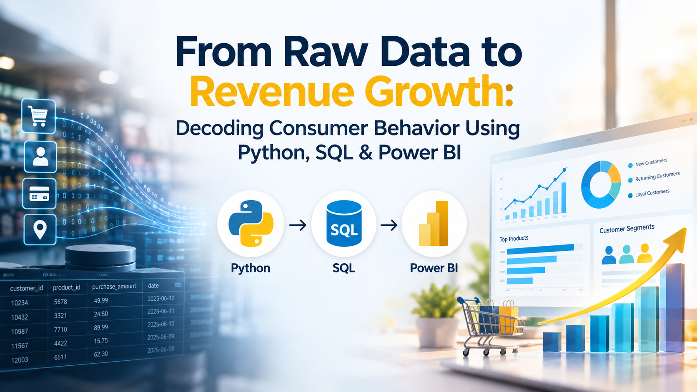
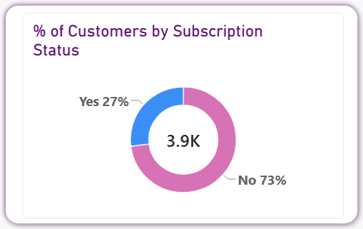
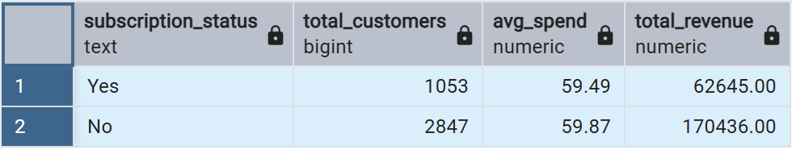
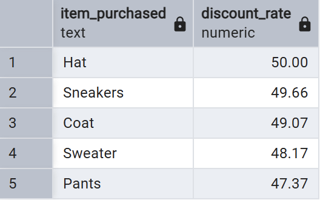
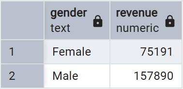
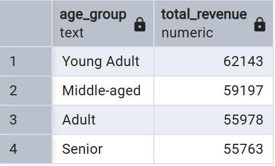

# From Raw Data to Revenue Growth: Decoding Consumer Behavior Using Python, SQL & Power BI

 

In modern retail, data is rarely the bottleneck—clarity is. E-commerce platforms and storefronts generate thousands of transactional records daily, yet leadership teams frequently struggle with a fundamental question: Which consumer behaviors actually drive long-term value, and where are we leaving money on the table?

 

## Why This Project?

As a data analyst, I’ve learned that raw numbers dont solve business problems; structured narrative and actionable strategy do. I undertook this Customer Shopping Behavior Analysis to bridge the gap between technical data engineering and executive decision-making. 

 

The primary objective wasn't just to aggregate historical metrics, but to solve a pressing enterprise challenge: **How can a retail organization leverage multi-channel shopping data to uncover purchasing trends, improve customer engagement, and optimize marketing and product strategies?**

 

To answer this comprehensively, I designed and executed a complete end-to-end analytics workflow. 
  

- **Data Preparation and Engineering (Python):** Cleaning, imputing, and feature-engineering raw transactional data. 
- **Relational Database Analysis (SQL / PostgreSQL):** Modeling transactions in a relational database to run deep-dive queries on customer loyalty, discount dependencies, and revenue distribution.
- **Executive Visualization (Power BI):** Building an interactive dashboard to give non-technical stakeholders direct exploration capabilities. 
- **Strategic Roadmap:** Translating data patterns into clear business recommendations to maximize revenue and loyalty.
 

## Unearthing the Signal: Engineering the Data Pipeline

Every reliable insight starts with disciplined data hygiene. Analyzing 3,900 customer records across 18 transactional variables required cleaning before attempting any deep-dive querying.
  

Using Python and Pandas, I focused on preparing the dataset for seamless relational modeling:
 

- **Imputation over Deletion:** Missing values in product review ratings were imputed using category-specific median ratings to preserve total record volume without biasing overall distributions. 
- **Schema Standardization:** Column headers were converted to standard snake_case, and redundant features (such as duplicate promo code indicators) were dropped to streamline downstream database performance. 
- **Feature Engineering:** I created demographic bins (age_group) and structured purchase frequency intervals to enable granular demographic querying. 
 

Once transformed, the clean dataset was ingested directly into PostgreSQL, creating a structured relational foundation for advanced analytical queries.

 

## What the Queries Revealed: The Story Behind the Numbers

Running targeted SQL queries across the dataset exposed several key behavioral insights that high-level averages usually obscure:

 

**1. The Subscription Bottleneck**

 

While 3,116 customers fell into the Loyal segment based on repeat purchase history, only 27% of total customers (1,053 buyers) were enrolled in the subscription program. Interestingly, average spend between subscribers ($59.49) and non-subscribers ($59.87) was nearly identical. The business was retaining repeat buyers, but completely failing to monetize or formalize that loyalty into predictable subscription revenue.

 

 

 

## 2. Discount Reliance vs. High-Value Spenders

Promotions drive sales volume, but do they erode profit margins unnecessarily? My SQL analysis revealed two critical nuances:

 

  - **839 customers** used discounts while still spending above the average store transaction value ($59.76). These high-value buyers did not require promotional pricing to make substantial purchases. 
  - Category-level discount dependence varied drastically: **Hats (50.00%), Sneakers (49.66%), and Coats (49.07%)** had roughly half of their total order volume tied directly to promotional discounts.

 

 

## 3. Demographic & Category Distribution

Total revenue reached **$233,081** across the portfolio, led by male shoppers ($157,890) compared to female shoppers ($75,191). Across age demographics, **Young Adults ($62,143) and Middle-aged ($59,197)** buyers generated the highest total revenue contributions. However, spending per purchase remained remarkably consistent across all age groups and shipping tiers—indicating that order size is driven by product selection rather than age or shipping urgency 

 

 

